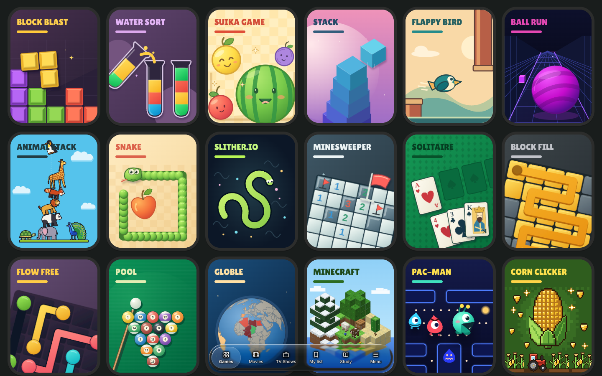

# Pocket Arcade

A static, private browser arcade with twenty-one playable games: **Suika Game, Water Sort, Block Blast, Stack, Snake, Slither.io, Minesweeper, Solitaire, Block Fill, Flow Free, Ball Run, Pool, Animal Stack, Flappy Bird, Globle, Minecraft, Pac-Man, Corn Clicker, Slipline, Tetris and Wordle**. Original SVG covers, a compact portrait-card library, favourites, local saves and an explicit offline download. No advertisements or currency. Accounts are optional for play and required for publishing leaderboard scores. Gameplay stays local; optional shared leaderboards use a Netlify score service, and Pool and Minecraft can be played online between devices ([setup](docs/MULTIPLAYER.md)).

The latest [gameplay correction record](docs/GAMEPLAY_CORRECTIONS.md) includes the four referenced scenes, six Animal Stack cutouts, actual interaction recordings and viewport checks.

## Run and build

Node.js 22 is recommended.

```sh
npm ci
npm run dev
# Or run the real local shared-score API and database:
npm run dev:online
```

```sh
npm run check
npm test
npx playwright install --with-deps chromium webkit
npm run test:e2e
npm run build
npm run verify:update
npm run verify:offline
```

The last two commands test the real production output using Chromium. `verify:offline` downloads the pack, disables network access, reloads and plays every game at both `/` and `/Qcc-games-/`, saves screenshots and records rendering intervals. `verify:update` checks that an open pair of older tabs retains its cached game while a new release waits, then activates safely after both close. Set `CHROMIUM_PATH` to use a system Chromium binary when needed. Game tests and shell tests are under `tests/`; the [release report](docs/DELIVERY.md) distinguishes actual results from unavailable checks.

## Play and save

Choose one of **20 NCEA study topics** on the first visit in a tab, then open the game library. During any game, press **Esc** to pause/save and read your selected textbook chapter. **Return to Arcade** restores the same game; change topics from the article selector. The choice lasts for this browser session, and all chapters are bundled locally. See [Study Mode and its verification evidence](docs/STUDY_MODE.md).

Use **Menu** on the glass island at the bottom for Study Mode, search, favourites, sound, motion, colour-blind settings and **Make all games available offline**. Sound starts muted. Games offer a shared back, pause, restart and rules toolbar, plus their own controls. Mouse and trackpad use the same pointer controls; suitable games also accept keyboard and touch input.

Scores, settings, favourites and compact game snapshots stay in this browser's local storage. If storage is blocked or full, play continues in memory and the menu explains that progress cannot be retained. Signed-in accounts can sync supported game snapshots between devices. Open **Menu → Leaderboards** to view shared scores for the fifteen scored games. Log in to publish personal bests; account scores queue offline until the connection returns. Guest scores and runs stay local and are not automatically imported into public rankings. Globle retains its own statistics and has no score leaderboard; Pac-Man keeps a local best score only; Corn Clicker keeps its own farm save, backups and statistics, and ranks lifetime kernels harvested on the leaderboards. Restart starts a new run; leaving a game saves its current state. A hidden tab pauses real-time play.

Offline play requires a successful download on the same browser, device and origin, using HTTPS or localhost. Browser eviction, private browsing, managed-device policies and network controls can prevent retention. The app cannot bypass them. After an update, close older arcade tabs so the new worker can activate; download the new pack to make all of that release available offline.

## The look

The games keep their original look: posters, their own controls and their own focus rings. The library's gold focus ring shows only after keyboard use. The library has no top bar. A glass tab bar at the bottom holds Games, Movies, TV Shows, My list, Study and Menu, at every screen width. Scrolling down shrinks it into a small glass capsule that keeps the current tab's icon, and scrolling up, or a tap on the capsule, brings it back. Menus and dialogs are glass sheets: bottom sheets on phones, and centred panels from 640 px.

Movies & TV uses a streaming-style design system. Its tokens and shared `ui-` components are in `src/theme.css`. The reference values were read as declared text from FrameXTV's public stylesheet and script. FrameXTV's anti-DevTools guard stopped its pages from rendering for automated inspection, and we did not bypass it. No FrameXTV code, CSS, icons, logo, wordmark, artwork or wording is used. The interface is original work under the Mauri Study Notes brand. The glass follows Apple's published Liquid Glass guidance in original CSS and TypeScript, with no Apple assets. See the [design references](docs/MOVIES_TV_DESIGN_REFERENCES.md).



## Deploy the same output

`npm run build` creates `dist/` with relative asset paths, hash routes and a service worker scoped to the directory in which it is served. The unchanged build supports an origin root and a repository subpath.

- **GitHub Pages:** enable GitHub Actions as the Pages source. The included [workflow](.github/workflows/pages.yml) runs verification and publishes `dist/` on pushes to `main` or `work`, or a manual dispatch. Repository Pages settings and account access are required.
- **Netlify:** import this repository. [netlify.toml](netlify.toml) sets `npm run build`, publishes `dist/`, selects Node 22 and sets security headers. The shared score function and `netlify/database/migrations/` are deployed alongside the site. Netlify provisions the database from the installed `@netlify/database` integration; no browser API keys or manually configured application secrets are needed. Database availability and usage follow the site’s Netlify plan.
- **Other static hosting:** serve `dist/` over HTTPS. No SPA rewrite is necessary because navigation uses `#/game/<id>`.

Shared online leaderboards require the Netlify function and database; static-only hosts continue to run the games but cannot serve the shared scores. See [leaderboard setup and verification](docs/LEADERBOARDS.md).

The Netlify project is **[NCEA Study](https://nceastudy.netlify.app)** (`nceastudy`), built from this repository's **main** branch. Publication is inspected through the Netlify connector; [deployment evidence and update status](docs/NETLIFY_DEPLOYMENT.md) record earlier releases. The ready static ZIP is included there too.

## Code and artwork

Vite + strict TypeScript, semantic DOM/SVG/Canvas, Matter.js for the two stacking games, Three.js loaded only by Ball Run, Globle and Minecraft, and globe.gl only by Globle. The library loads no game engines. Each game has a separate deterministic rules model and implements the shared [module contract](src/core/types.ts). See [architecture](ARCHITECTURE.md), [test plan](TEST_PLAN.md) and the [twelve specialist build record](docs/AGENT_BUILDS.md).

All twelve cover illustrations were remade with the installed [SVG generation skill](.agents/skills/svg-skill/SKILL.md). The authored sources are in `public/game-art/<id>/cover.svg`; `scripts/generate-covers.py` reproduces the cover set. See [artwork notes](docs/ARTWORK.md). Fonts are locally bundled with their OFL licence; [dependency and font notices](public/THIRD_PARTY_NOTICES.txt) also ship in the static build. No original reference screenshots or proprietary game artwork are distributed.

The repository's pre-existing agent skill collection remains intact; its original README is preserved in [workspace skill notes](docs/WORKSPACE_SKILLS.md). Each game records its actual loaded skills, documentation sources and gaps in its own `SKILL_USAGE.md`.

Minecraft here is an independent survival and creative browser sandbox that began as a rebuild of the MIT-licensed [Minecraft-Javascript-Edition](https://github.com/ashish0kumar/Minecraft-Javascript-Edition). It has 23 biomes with caves, ores and structures, 147 block types, 284 items, 162 crafting and 25 smelting recipes, furnaces, chests, armour and shields, hunger, health, XP and status effects, 16 mobs (farm animals, wolves, squid, zombies, skeletons, creepers, spiders, endermen, slimes and their variants), day and night, weather, flowing water and lava, fire, TNT, crops, beds, advancements, sound, and keyboard, mouse, touch and gamepad controls. It was rebuilt for speed: worker-thread terrain, flood-fill lighting, greedy-meshed chunks with smooth lighting, a 20-byte vertex format, batched mob rendering and adaptive resolution. Every texture, model and sound is generated in code to look like the vanilla game; apart from its library cover it ships no image or audio files, and no Mojang assets. See [the optimisation record and benchmarks](docs/BLOCKCRAFT.md) and the [feature briefs](src/games/blockcraft/FEATURES.md).

Flappy Bird uses an original marsh swift and reed-gate illustration; see [local checkpoint and test evidence](docs/FLAPPY_BALL_RUN.md). Ball Run is a seeded Easy, Medium or Hard course of curves, banks, ribbons, crests and drops whose speed climbs slowly to a 40–62 m/s cap, with each cyan gate a permanent boost and dense random block patterns that always leave a route the ball can steer through; see [the redesign checkpoint](docs/BALL_RUN_REDESIGN.md).

This independent Pac-Man browser adaptation uses classic arcade rules: chasers with their own targets, scatter and chase waves, power berries, eyes returning home, a side tunnel, bonus treats and faster levels. Its characters, maze and SVG art are original. See [its spec](src/games/maze-muncher/SPEC.md).

Corn Clicker is an original corn-themed incremental game: click the cob, hire producers from Farmhands to the Corniverse, collect golden cobs, grow and cross-breed corn in the garden, and Replant for Golden Seeds. It keeps earning while you are away (50% for up to 8 hours), autosaves with backups and export codes, and runs in one tab at a time. See [its spec](src/games/corn-clicker/SPEC.md).

## Movies & TV

Movies & TV opens from the Movies, TV Shows and My list tabs on the glass island. It is a streaming-style section with real TMDB posters and backdrops, full-catalog search, genres, rails, title and season pages, episodes and a device-local list. Playback uses one of four public iframe players (FrameXTV, VidLink, VixSrc or VidSrc), isolated in a cross-origin sandbox. If a server does not start, QCC tries the next one and remembers the one that worked. Where a server can, playback resumes at the saved time. Study Mode unloads the player and offers manual resume. Game scores, saves and offline downloads remain separate.

TMDB and the streaming servers receive ordinary image and playback requests. External availability, tracking and distribution rights are not verified by QCC. No provider scripts run in the parent page, and no DRM bypass, stream extraction or account forwarding is implemented. See [setup and provider/privacy details](docs/MOVIES_TV.md), [design references](docs/MOVIES_TV_DESIGN_REFERENCES.md) and [verification results](docs/MOVIES_TV_TEST_RESULTS.md), which predate the redesign.

**Slipline** is a deterministic arrow-extraction puzzle: clear each route in its direction, avoid blocked moves, and preserve hearts through an endless campaign.

Tetris is a falling-piece puzzle: arrange seven kinds of quads, clear lines, and build a local best score.

## Wordle

Wordle is a daily five-letter puzzle with unlimited practice rounds, separate statistics and accessible colour cues. See [its spec](src/games/fivefold/SPEC.md).
