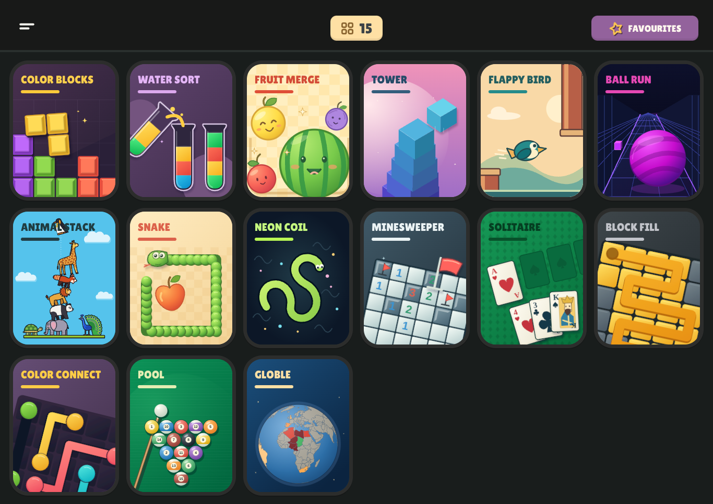

# Pocket Arcade

A static, private browser arcade with twelve playable games: **Fruit Merge, Water Sort, Color Blocks, Tower, Snake, Minesweeper, Solitaire, Block Fill, Color Connect, Ball Run, Pool and Animal Stack**. Original SVG covers, a compact portrait-card library, favourites, local saves and an explicit offline download. No accounts, advertisements, currency, tracking or gameplay server.



## Run and build

Node.js 22 is recommended.

```sh
npm ci
npm run dev
```

```sh
npm run check
npm test
npx playwright install --with-deps chromium webkit
npm run test:e2e
npm run build
npm run verify:update
npm run verify:offline
```

The last two commands test the real production output using Chromium. `verify:offline` downloads the pack, disables network access, reloads and plays every game at both `/` and `/Qcc-games-/`, saves screenshots and records rendering intervals. `verify:update` checks that an open pair of older tabs retains its cached game while a new release waits, then activates safely after both close. Set `CHROMIUM_PATH` to use a system Chromium binary when needed. Game tests and shell tests are under `tests/`; the [release report](docs/DELIVERY.md) distinguishes actual results from unavailable checks.

## Play and save

Open the library directly. Use the hamburger for search, sound, motion, colour-blind settings and **Make all games available offline**. Sound starts muted. Games offer a shared back, pause, restart and rules toolbar, plus their own controls. Mouse and trackpad use the same pointer controls; suitable games also accept keyboard and touch input.

Scores, settings, favourites and compact game snapshots stay in this browser's local storage. If storage is blocked or full, play continues in memory and the menu explains that progress cannot be retained. There is no cloud sync. Restart starts a new run; leaving a game saves its current state. A hidden tab pauses real-time play.

Offline play requires a successful download on the same browser, device and origin, using HTTPS or localhost. Browser eviction, private browsing, managed-device policies and network controls can prevent retention. The app cannot bypass them. After an update, close older arcade tabs so the new worker can activate; download the new pack to make all of that release available offline.

## Deploy the same output

`npm run build` creates `dist/` with relative asset paths, hash routes and a service worker scoped to the directory in which it is served. The unchanged build supports an origin root and a repository subpath.

- **GitHub Pages:** enable GitHub Actions as the Pages source. The included [workflow](.github/workflows/pages.yml) runs verification and publishes `dist/` on pushes to `main` or `work`, or a manual dispatch. Repository Pages settings and account access are required.
- **Netlify:** import this repository. [netlify.toml](netlify.toml) sets `npm run build`, publishes `dist/`, selects Node 22 and sets security headers. No API keys or environment secrets are needed.
- **Other static hosting:** serve `dist/` over HTTPS. No SPA rewrite is necessary because navigation uses `#/game/<id>`.

A newspaper-style Netlify project, **the-daily-ledger-kh16**, has been created at the user's request. Connector publication is blocked because its available tools expose no upload/create-deploy action; the arcade is **not published** there yet. See [the deployment handoff and ready upload ZIP](docs/NETLIFY_DEPLOYMENT.md). Local root/subpath tests do not establish a hosted deployment.

## Code and artwork

Vite + strict TypeScript, semantic DOM/SVG/Canvas, Matter.js for the two stacking games, and Three.js loaded only by Ball Run. The library loads no game engines. Each game has a separate deterministic rules model and implements the shared [module contract](src/core/types.ts). See [architecture](ARCHITECTURE.md), [test plan](TEST_PLAN.md) and the [twelve specialist build record](docs/AGENT_BUILDS.md).

All twelve cover illustrations were remade with the installed [SVG generation skill](.agents/skills/svg-skill/SKILL.md). The authored sources are in `public/game-art/<id>/cover.svg`; `scripts/generate-covers.py` reproduces the cover set. See [artwork notes](docs/ARTWORK.md). Fonts are locally bundled with their OFL licence; [dependency and font notices](public/THIRD_PARTY_NOTICES.txt) also ship in the static build. No original reference screenshots or proprietary game artwork are distributed.

The repository's pre-existing agent skill collection remains intact; its original README is preserved in [workspace skill notes](docs/WORKSPACE_SKILLS.md). Each game records its actual loaded skills, documentation sources and gaps in its own `SKILL_USAGE.md`.
