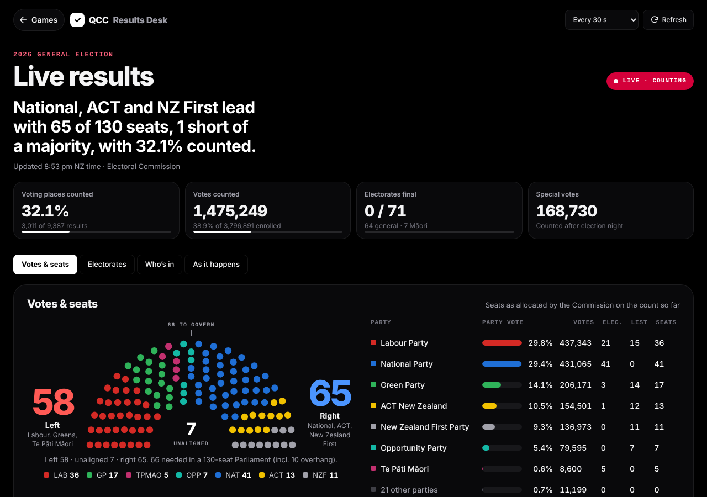

# QCC Results Desk

`#/election` shows live results for the 2026 New Zealand general election. The quickest way in is the **Election 2026** strip at the top of the games library: it shows the live headline, how much is counted and a seat strip, and opens Results Desk in one tap. **Menu → Election results** goes there too. The strip shows until 1 December 2026, after the official results. It is unofficial: the numbers are the Electoral Commission's preliminary election-night count, and official results follow once special votes are counted.

The design follows the Movies & TV tokens in `src/theme.css`. Two public results sites informed the feature set: [ResultsDesk.nz](https://resultsdesk.nz/) (tabs for votes and seats, electorates and trends; electorate filters; coalition builder) and [Election2026.nz](https://election2026.nz/live/) (a one-line headline, left and right blocs around the chamber, "who's in" lists, an event feed and the pace of the count). No code, artwork, logos or wording from either site is used.

## Views

- **Votes & seats**: a headline sentence, the chamber with left and right bloc totals and the majority mark, the party vote table (votes, electorate, list and total seats), **Build a government** (pick parties and compare their seats with the majority) and **Electorate leads** (one tile per electorate, coloured by the party ahead; solid when final).
- **Electorates**: search by electorate or candidate; filter by General or Māori, leading party, count status (Counting, Complete, No results yet) and close races (under 5%); sort by name, closest, most counted or most votes. Each row opens the electorate: candidate votes, party votes there, voting places and informal votes.
- **Who's in**: each seated party's electorate leaders, then its list in rank order, skipping list candidates already in on an electorate. The last list member in and the next in line are marked.
- **As it happens**: party vote share against the count, lead changes, finished electorates and count milestones, the pace of the count, the closest races and the electorates that reported most recently.

Party colours identify the parties; each chip's text colour is chosen for at least 4.5:1 contrast. Refresh is every 30 seconds by default (15 s to 2 min, or off) and stops while the tab is hidden or Study is open.

## Data

The Commission's feed at `https://media.election.net.nz/xml` sends no CORS headers, and the site's Content-Security-Policy allows only same-origin connections. So the browser asks `/api/election`:

- `server/election-feed.ts` fetches `election.xml`, `parties.xml`, `electorates.xml`, `candidates.xml`, `statistics.xml` and the `eNN/eNN.xml` electorate files, parses them and returns one JSON bundle. Cloudflare's free plan allows 50 subrequests per request, and the whole feed is 76 files, so the page asks for `?part=1` (electorates 1–36) and `?part=2` (37–71) and merges them; the library strip asks for `?part=summary`, which reads no electorate files. Without a part, everything is fetched at once (dev and tests). Each isolate keeps each part for 15 seconds, so many readers share one upstream round. If an electorate file fails, the previous copy of that electorate is kept; if the whole feed fails, the last good bundle is served with `x-qcc-stale: 1`, otherwise a 502.
- `functions/api/election.ts` serves it on Cloudflare Pages (already routed by `public/_routes.json`). `vite.config.ts` serves the same handler in `npm run dev`.
- Māori electorates are identified by name. The election-wide "voting places counted" is the Commission's count of voting-place results, so its total is `total_voting_place_results`.

The trend lines and the event feed are worked out in the browser from successive updates. Only a newer update can add events, and an electorate whose file failed never counts as a lead change. They are kept in `localStorage` (`qcc:election:v1`), with the refresh interval and coalition choice. The feed has no history of its own, so they start when you first open the page.

## Tests

- `tests/election/election.test.ts`: parsing, bundle building and fallbacks, the handler cache, leads, filters, the headline, list allocation, events, trend points, the chamber layout, unique tile codes for all 71 electorates and chip contrast.
- `tests/election/election.spec.ts`: the library strip and the Menu entry, every tab with a fixed feed, a background update that keeps the search box's focus and text, and the error and retry path.
